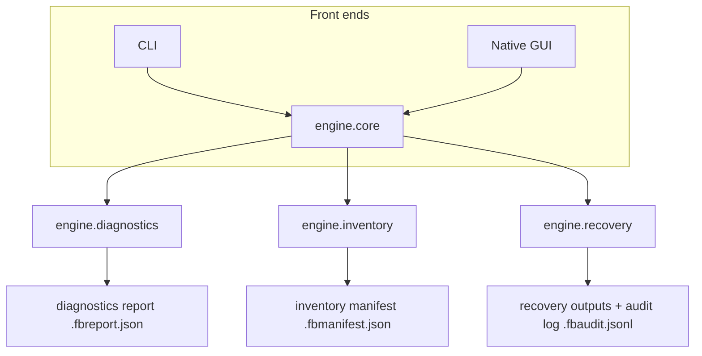

# Architecture

Normative for module boundaries and classification semantics. The concrete technology stack is deferred to ADR-0002 (see [Decisions](decisions/)) and lands with the prototype review ([#1](https://github.com/turinglambdaai/fileboundary/issues/1), [#2](https://github.com/turinglambdaai/fileboundary/issues/2)).

## Context

Third-party transparent file encryption on Windows typically combines:

- a **minifilter** driver registered with the Filter Manager, intercepting file I/O at some altitude;
- **DLL injection** into user processes plus **API hooks** on file APIs (`CreateFile`, `ReadFile`, `WriteFile`, …) so that whitelisted processes see plaintext while others may see ciphertext;
- a **process whitelist** — usually maintained by a management component or key management service;
- a **key management service** holding per-file or per-policy keys;
- transparent encryption on write and decryption on read for whitelisted processes.

FileBoundary does not modify any of these components. It observes them, measures the file corpus, drives authorized recovery, and verifies outcomes.

## Principles

1. **One engine, two front ends.** All domain logic lives in the engine; the CLI and GUI are thin adapters over it.
2. **Diagnostics observe; they do not modify.** No diagnostic unloads, patches, or reconfigures protection components.
3. **Evidence over assumption.** Every reported fact carries its evidence class: measured, heuristic, or inferred. Nothing heuristic is ever reported as fact.
4. **Local-first.** No telemetry, no network calls, no accounts. All artifacts stay on the machine, outside this repository.
5. **Agent parity.** Anything the GUI can do, the CLI can do, with the same JSON contract ([cli-contract.md](cli-contract.md)).

## Module map

| Module | Responsibility | Depends on |
|---|---|---|
| `engine.core` | domain models, scan orchestration, manifest/state store, reporting primitives | — |
| `engine.diagnostics` | minifilter inventory, driver/service inspection, process module enumeration, hook heuristics, probe-file I/O observation | `engine.core` |
| `engine.inventory` | filesystem walk, format sniffing, entropy/structure classification, SHA-256, persistent manifest | `engine.core` |
| `engine.recovery` | authorized recovery adapters, verification pipeline, audit log | `engine.core` |
| `cli` | argument parsing, JSON envelope, exit codes; no domain logic | `engine.*`, `contracts` |
| `gui` | native Windows presentation; no domain logic | `engine.*` (typed boundary) |
| `contracts` | versioned JSON schemas shared by CLI, GUI, tests, and agents | — |

Dependency rule: dependencies point downward only. `contracts` depends on nothing. The GUI and CLI never import each other. Engine modules never import a front end. Violations of this rule are review blockers.

## Diagnostics module — planned, [#3](https://github.com/turinglambdaai/fileboundary/issues/3)

What it enumerates, and how it stays read-only:

- **Filter Manager inventory** — registered minifilters, altitudes, instances, frames, via Filter Manager enumeration interfaces.
- **Driver and service configuration** — filter drivers and related services as reported by the Service Control Manager and driver store; configuration only, never modification.
- **Process module enumeration** — loaded modules in processes of interest (whitelisted-looking applications vs. non-whitelisted ones).
- **Hook heuristics** — IAT/inline-hook detection on file APIs in selected processes. These checks are **heuristics** and are always labeled `heuristic` in output; a heuristic finding is a lead, not a verdict.
- **Probe-file observation** — create a probe file in a designated location, write known content, read it back, and observe the transformation. This is the cleanest fact source: it measures behavior without touching user data.

Every check that requires elevation reports `requiresElevation` in the JSON report instead of failing silently or skipping quietly.

## Inventory module — planned, [#4](https://github.com/turinglambdaai/fileboundary/issues/4)

- **Resumable scan** — walk is persisted; an interrupted scan resumes without rehashing.
- **Format sniffing** — magic bytes plus structural validation of the container/document format. Header recognition alone never proves plaintext (see below).
- **Classification** — per-file label with confidence, from measured structure and entropy:

| Label | Meaning | Does NOT mean |
|---|---|---|
| `plaintext` | structure validates end-to-end, entropy consistent with format | the file was never encrypted; only that it reads as its format |
| `encrypted-recognized` | a known encryption-wrapper format is identified | the file can be recovered, or by whom |
| `likely-encrypted` | high entropy and/or structural inconsistency with claimed extension | the specific protection product, or the key location |
| `unknown` | evidence is inconclusive | anything |

- **SHA-256** for every scanned file; the manifest records path, size, timestamps, hash, label, evidence.
- **Manifest persistence** — `.fbmanifest.json` (reserved extension, see [cli-contract.md](cli-contract.md)), written only to operator-designated output locations.

## Recovery module — planned, [#5](https://github.com/turinglambdaai/fileboundary/issues/5)

- **Authorized adapters only** — vendor management console, export paths through whitelisted applications, or owner-held keys. There is no fallback to unauthorized mechanisms, ever ([security.md](security.md)).
- **Verification pipeline** — hash comparison (fixture round-trip where possible), format validation, independent-reader open test, content-level checks. All three verdicts (`verified`, `unverified`, `failed`) require recorded evidence ([security.md](security.md#integrity-semantics)).
- **Audit log** — append-only JSONL (`.fbaudit.jsonl`), one record per attempt with evidence references.

## Front ends

- **CLI** — thin adapter over the engine; the JSON contract is normative ([cli-contract.md](cli-contract.md)).
- **GUI** — native Windows presentation. Every engine capability is reachable from the CLI; the GUI adds no capability that bypasses the contract.

## Data flow

All outputs are written to operator-designated locations outside the repository. Artifacts never contain file content — only metadata, hashes, and verdicts with evidence references.

## Technology posture

**Owner preference: Racket-first.** A headless Racket engine and JSON CLI are the initial candidates; [Rivet](https://github.com/turinglambdaai/rivet) with a first-party Windows WinUI 3 host is the preferred GUI spike, while [Glaze](https://github.com/turinglambdaai/glaze) with a Windows WebView2 host is an explicitly supported fallback to evaluate. Product functionality must not depend on UI framework availability.

Use Racket FFI or fixed bounded read-only diagnostics for Windows integration where reliable; isolate necessary Win32/COM functionality into narrow native user-mode modules when the real API/ABI warrants it. Do not introduce a kernel driver merely to read the filter stack.

The original C#/WinForms v0.1 source is a reference prototype, **not** the selected implementation stack. The actual stack, native interoperability and deployment trade-offs remain **proposed** in [ADR-0002](decisions/adr-0002-prototype-stack.md) until Windows spikes, CLI/engine tests and package verification exist. Reusable Windows diagnostic/format libraries may be considered for Racket Package Catalog **only after** tests, API review and separate owner approval. No public publication is authorized by this proposal.

## Failure posture

- A diagnostic that cannot run says so explicitly (`requiresElevation`, `accessDenied`) — never silently empty.
- A classification always carries its evidence class.
- A recovery attempt always ends in an audit record, regardless of outcome.
- An unrecoverable file is documented and closed as unrecoverable via authorized paths — it is never silently dropped.
